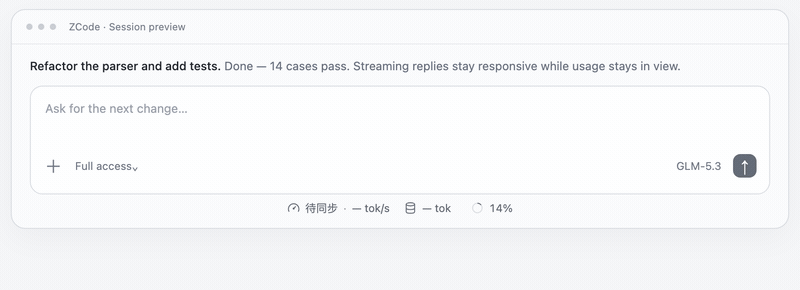
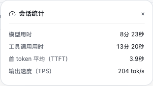
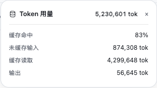
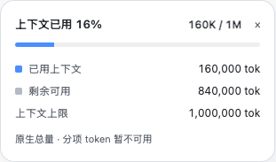
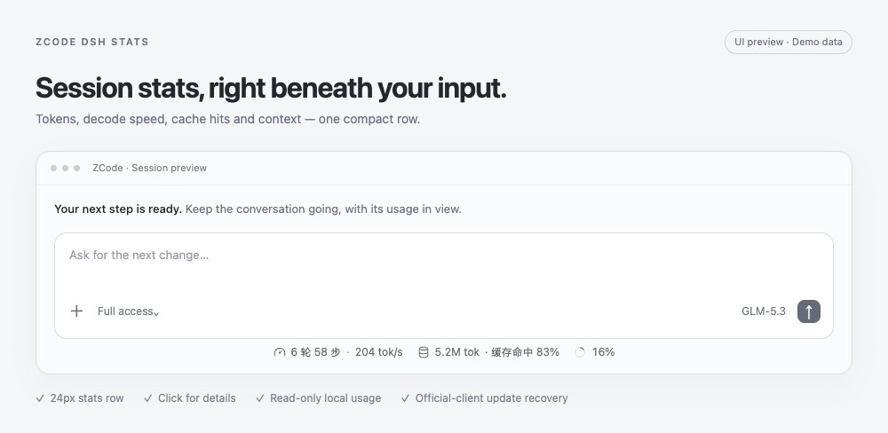
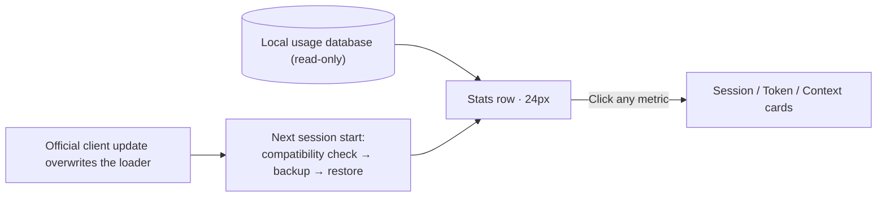

<div align="center">

# ZCode DSH Stats

**A 24px stats row right beneath your input: turns, decode speed, tokens, cache hits, context usage.**
The compact-statistics experience of DeepSeek Harness (DSH) for the official ZCode Desktop — no source build, and automatic restoration after client updates.

[](https://github.com/BLGZZY/zcode-dsh-stats/actions/workflows/checks.yml)
[](LICENSE)




*Demo data. Once installed, the row reads your current session's local usage records; the animation is rendered deterministically from [docs/record-demo.html](docs/record-demo.html) and can be regenerated at any time.*

简体中文 · [English](README.md)

[✨ At a glance](#-at-a-glance) · [⚡ Install](#-install) · [⚙ How it works](#-how-it-works) · [🔄 After updates](#-after-zcode-updates) · [🛡 Privacy](#-data-and-privacy) · [📚 Full guide](docs/guide.md)

</div>

## ✨ At a glance

| See | Understand |
| --- | --- |
| **6 turns · 58 steps · 204 tok/s** | Completed conversation turns, main requests and average decode speed |
| **5.2M tok · 83% cache hits** | Cumulative token usage and the input's cache-hit ratio |
| **16% context** | Native context usage for the active conversation |
| **Click any metric** | Pop open the session / token / context cards |

The row is **24px high**: it adapts to narrow panes, follows light/dark mode, and keeps each split pane's statistics separate. Speed updates after requests complete, not token by token.

<details>
<summary><b>🔍 The three detail cards</b></summary>

**Session performance** — model/tool time, average TTFT and decode speed.



**Token usage** — cache hits, uncached input, cache reads and output.



**Context capacity** — native usage, remaining tokens and an accessible progress bar. ZCode does not expose per-category token counts.



</details>

<details>
<summary><b>🖼 Static screenshots (light / dark)</b></summary>

<picture>
  <source media="(prefers-color-scheme: dark)" srcset="docs/assets/showcase-dark.png">
  
</picture>

</details>

## ⚡ Install

> [!IMPORTANT]
> This is an unofficial, experimental extension. Setup **backs up first**, then adds a loader entry to the installed client's `app.asar`. It uses no official composer extension API and never rebuilds ZCode.

### Paste this into your agent (recommended)

You need an agent that can operate the terminal on this PC or Mac (a web-only chat or remote sandbox cannot write to your machine). It handles the environment checks, installation, recovery setup and verification on its own:

```text
Install ZCode DSH Stats on this Windows PC or Mac and enable automatic restoration after official ZCode updates.
First read and follow https://raw.githubusercontent.com/BLGZZY/zcode-dsh-stats/main/INSTALL_FOR_AGENTS.md
Complete the environment checks, source download, installation and verification. You may install an official Python package through an existing Homebrew (macOS) or winget (Windows) if needed; do not silently bootstrap a package manager.
Do not build ZCode Dev or force-quit a running ZCode. If system permissions or compatibility checks block installation, explain the actual blocker and the one step I need to take.
Report whether installation and automatic recovery succeeded, and whether I still need to restart ZCode.
```

When it finishes, it will tell you whether ZCode still needs a restart. **Fully quit and reopen ZCode**, then open an existing local conversation — the row appears beneath the input card (a new draft has no statistics yet). You can also read the [agent installation guide](INSTALL_FOR_AGENTS.md) first.

<details>
<summary><b>🛠 No agent? Install manually (click to expand)</b></summary>

Requires Python 3.11+, Git and the installed official ZCode Desktop; macOS (Apple Silicon) and Windows 11 x64 are supported, Linux is not.

```sh
git clone https://github.com/BLGZZY/zcode-dsh-stats.git
cd zcode-dsh-stats
```

**macOS** (Terminal, or double-click `Install.command`):

```sh
python3 setup_auto.py enable
```

**Windows** (PowerShell):

```powershell
.\Install.ps1
```

Successful setup reports `auto-restore-enabled`; fully quit and reopen ZCode to apply it.

Windows notes: the installer discovers an installed Python 3.11+ and keeps its absolute path — pass `-PythonPath 'C:\path\to\python.exe'` if it is outside PATH; pass `-Asar 'C:\path\to\ZCode\resources\app.asar'` for a custom ZCode location; if PowerShell blocks scripts, confirm `py -3 --version` is 3.11+ and run `py -3 setup_auto.py enable` (no execution-policy change needed); if the archive is reported in use, fully quit ZCode normally and rerun.

See [platform setup](docs/guide.md#install-and-inspect).
</details>

## ⚙ How it works



- The collector opens the local usage database **read-only** and selects numeric usage for the exact current session. It never reads prompts, touches API keys, sends telemetry or makes model requests.
- Installation writes exactly three things: the loader entry inside `app.asar` (with a verified backup), the extension's own files and backups, and a user-level local plugin registration.

## 🔄 After ZCode updates

An installed local plugin guards the row: when a session starts or resumes it checks the loader, and if an update replaced it, the plugin verifies compatibility, backs up the new archive and restores the entry — **effective on the next app start**. No forced exit, scheduled task or service is used. On Windows a running app can lock the archive; restoration is then deferred until that app exits normally (waiting up to 24 hours).

<details>
<summary><b>❓ When is restoration paused? How do I check the state?</b></summary>

- Permission errors or incompatible client changes pause restoration; see [update recovery](docs/guide.md#update-recovery).
- It restores this component only: it does not update ZCode or download new extension versions. Disabling recovery or removing the component cancels a pending repair.
- On Windows, `deferred-until-exit` in the status file means waiting, not repaired.
</details>

## 🧩 Update or remove

| Action | macOS | Windows |
| --- | --- | --- |
| Update | `git pull --ff-only` + `python3 setup_auto.py enable` | `git pull --ff-only` + `.\Install.ps1` |
| Remove | `python3 install.py remove` (or double-click `Remove.command`) | `.\Remove.ps1` |
| Recovery only | `python3 setup_auto.py disable` | `py -3 setup_auto.py disable` |

Pass the same `-Asar` / `--asar` for a custom installation. Fully quit and reopen ZCode after any change.

## 📋 Verified environments

| Environment | Install | Live stats UI | Update recovery |
| --- | :-: | :-: | :-: |
| macOS (Apple Silicon) · ZCode 3.16.3 | ✅ | ✅ | — |
| Windows 11 x64 · ZCode 3.14.4 | ✅ | ✅ | ✅ same-version drill |
| Windows 11 x64 · ZCode 3.16.3 | ✅ | ✅ | ✅ real 3.14.4 → 3.16.3 upgrade |

Windows verification used Python 3.11.4 from an existing Anaconda base installation. On 2026-10-25 a real official stable-channel upgrade completed, and the loader was restored automatically after normal app exit. See the [verification table](docs/guide.md#verified-configurations).

## 🛡 Data and privacy

- The usage database is opened **read-only**, selecting numeric usage for the exact current session; no prompts, API keys, telemetry or model requests.
- Only completed main requests are counted. Local retention, missing timing samples and legacy cache accounting affect totals; see [metric definitions](docs/guide.md#metrics).
- Recovery contributes a short maintenance notice to the current session when a repair succeeds, fails or is deferred until app exit.

## 📚 Docs and contributing

- [User guide](docs/guide.md) · [中文完整指南](docs/guide.zh-CN.md) · [Development, tests and contributions](CONTRIBUTING.md) · [Implementation contract](spec.json)
- Found a problem? Please [open an issue](https://github.com/BLGZZY/zcode-dsh-stats/issues).

## 🙏 Credits and license

The loading approach and ASAR format handling are based on [xhwxt/zcode-token-usage-statusbar](https://github.com/xhwxt/zcode-token-usage-statusbar); its [MIT notice](vendor/LICENSE) is retained. The interface is inspired by DeepSeek Harness; its product runtime is not bundled. This project is not affiliated with ZCode.

[MIT](LICENSE) © 2026 ZCode DSH Stats contributors
