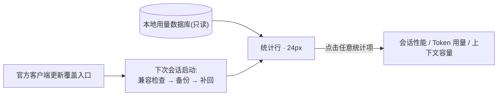

<div align="center">

# ZCode DSH Stats

**输入框正下方的一行 24px 统计条:轮数、速度、token、缓存命中、上下文占用。**
参考 DeepSeek Harness(DSH)的紧凑统计体验,为官方 ZCode Desktop 而来,无需自行编译;客户端更新后自动恢复。

[](https://github.com/BLGZZY/zcode-dsh-stats/actions/workflows/checks.yml)
[](LICENSE)


*演示数据。安装后读取你当前会话的本地用量记录;截图由 [docs/record-demo.html](docs/record-demo.html) 确定性渲染,可随时重新生成。*

[English](README.md) · 简体中文

[✨ 一眼看清](#-一眼看清) · [⚡ 安装](#-安装) · [⚙ 工作原理](#-工作原理) · [🔄 更新后](#-zcode-更新后) · [🛡 隐私](#-数据与隐私) · [📚 完整指南](docs/guide.zh-CN.md)

</div>

## ✨ 一眼看清

| 看到 | 含义 |
| --- | --- |
| **6 轮 · 58 步 · 204 tok/s** | 已完成的对话轮数、主请求数,以及最近 5 条请求的加权输出速度 |
| **5.2M tok · 缓存命中 83%** | 累计 token 用量,以及输入的缓存命中比例 |
| **16% 上下文** | 当前会话的原生上下文占用 |
| **点击任意统计项** | 弹出会话性能 / Token 用量 / 上下文容量卡片 |

统计行只有 **24px 高**:窄窗口自动精简、适配明暗主题、分屏会话各自统计。速度取最近 5 条完成请求的加权值,在请求完成后更新,并非逐 token 的瞬时值。

<details>
<summary><b>🔍 三张详情卡片</b></summary>

**会话性能** — 模型/工具用时、平均首 token 延迟、输出速度。


**Token 用量** — 缓存命中、未缓存输入、缓存读取和输出。


**上下文容量** — 原生已用量、剩余空间和进度条。ZCode 暂未提供分项 token 计数。


</details>

<details>
<summary><b>🖼 静态截图(明 / 暗)</b></summary>

<picture>
  <source media="(prefers-color-scheme: dark)" srcset="docs/assets/showcase-dark.png">
  
</picture>

</details>

## ⚡ 安装

> [!IMPORTANT]
> 非官方、实验性扩展。安装会**先备份**,再向已安装客户端的 `app.asar` 添加加载入口;不依赖官方输入框插件 API,也不会重新编译 ZCode。

### 把这段话复制给 Agent(推荐)

需要一个能操作你本机终端的 agent(网页聊天或远程沙箱无法写入本机)。它会自己完成环境检查、安装、启用更新自动恢复和结果验证:

```text
请在我这台 Windows 或 Mac 电脑上安装 ZCode DSH Stats,并启用官方 ZCode 更新后的自动恢复。
先读取并遵循安装指南:https://raw.githubusercontent.com/BLGZZY/zcode-dsh-stats/main/INSTALL_FOR_AGENTS.md
请直接完成环境检查、获取代码、安装和结果验证;必要时可通过已有 Homebrew(macOS)或 winget(Windows)安装官方 Python 包,不要静默安装包管理器。
不要构建 ZCode Dev,不要强退正在运行的 ZCode。若被系统权限或兼容性检查阻止,请说明实际原因和我需要做的一步操作。
最后告诉我是否安装成功、自动恢复是否启用,以及是否还需要重启 ZCode。
```

完成后 agent 会告诉你是否还需要重启;**完全退出并重新打开 ZCode**,进入一个已有的本地会话,输入框下方就是统计行(新草稿暂无统计)。也可以先阅读 [Agent 安装指南](INSTALL_FOR_AGENTS.md)再决定。

<details>
<summary><b>🛠 不用 Agent?手动安装(点击展开)</b></summary>

需要 Python 3.11+ 与 Git(无 pip 依赖)和已安装的官方 ZCode Desktop;支持 macOS(Apple Silicon)与 Windows 11 x64,暂不支持 Linux。

```sh
git clone https://github.com/BLGZZY/zcode-dsh-stats.git
cd zcode-dsh-stats
```

**macOS**(终端,或双击 `Install.command`):

```sh
python3 setup_auto.py enable
```

**Windows**(PowerShell):

```powershell
.\Install.ps1
```

成功会显示 `auto-restore-enabled`,完全退出并重开 ZCode 后生效。

Windows 补充:安装器自动寻找已装的 Python 3.11+ 并保留其绝对路径,不在 PATH 时传 `-PythonPath 'C:\path\to\python.exe'`;自定义 ZCode 位置传 `-Asar 'C:\path\to\ZCode\resources\app.asar'`;PowerShell 阻止脚本时,确认 `py -3 --version` 为 3.11+ 后直接运行 `py -3 setup_auto.py enable`(无需修改执行策略);提示文件被占用时,正常完全退出 ZCode 后重跑即可。

详见[平台安装说明](docs/guide.zh-CN.md#安装与卸载)。
</details>

## ⚙ 工作原理



- 采集器**只读**打开本地用量数据库,按当前会话 ID 查询数字统计;不读提示词、不访问 API key、不上传遥测、不额外调用模型。
- 安装只写入三处:`app.asar` 中的加载入口(有备份)、组件自身文件与备份、用户级本地插件注册。

## 🔄 ZCode 更新后

统计由已安装的本地插件守护:新建或恢复会话时检查入口,若被官方更新覆盖,自动做兼容检查、备份新档并补回,**下次启动生效**。不强退应用,不创建计划任务或服务。Windows 下运行中的应用可能锁定文件,恢复会延后到应用正常退出后执行(最多等待 24 小时)。

<details>
<summary><b>❓ 何时暂停恢复?如何确认状态?</b></summary>

- 权限不足或新版结构不兼容时暂停恢复,详见[自动恢复说明](docs/guide.zh-CN.md#官方更新后自动恢复)。
- 它只恢复本组件:不升级 ZCode、不联网下载新版本;禁用恢复或卸载组件会取消待执行修复。
- Windows 状态文件显示 `deferred-until-exit` 时,表示等待中而非已修复。
</details>

## 🧩 升级与卸载

| 操作 | macOS | Windows |
| --- | --- | --- |
| 更新组件 | `git pull --ff-only` + `python3 setup_auto.py enable` | `git pull --ff-only` + `.\Install.ps1` |
| 卸载组件 | `python3 install.py remove`(或双击 `Remove.command`) | `.\Remove.ps1` |
| 只关自动恢复 | `python3 setup_auto.py disable` | `py -3 setup_auto.py disable` |

自定义安装路径请传同一个 `-Asar` / `--asar`。任何改动后,完全退出并重开 ZCode 生效。

## 📋 已验证环境

| 环境 | 安装 | 实时统计 UI | 更新自动恢复 |
| --- | :-: | :-: | :-: |
| macOS(Apple Silicon)· ZCode 3.16.3 | ✅ | ✅ | — |
| Windows 11 x64 · ZCode 3.14.4 | ✅ | ✅ | ✅ 同版本演练 |
| Windows 11 x64 · ZCode 3.16.3 | ✅ | ✅ | ✅ 真实升级 3.14.4 → 3.16.3 |

Windows 验证使用现有 Anaconda 基础安装中的 Python 3.11.4;2026-10-25 完成官方稳定通道真实升级,应用正常退出后入口自动补回。详见[验证表](docs/guide.zh-CN.md#验证)。

## 🛡 数据与隐私

- 用量数据库**只读**打开,仅按当前会话 ID 查询数字;不读提示词、不访问 API key、不发遥测、不调用模型。
- 只统计已完成的主请求;记录保留期、缺失计时和历史缓存口径会影响数字,见[指标口径](docs/guide.zh-CN.md#数据与显示)。
- 自动恢复在修复成功、失败或延后至应用退出时,向当前会话提供一条简短维护状态。

## 📚 文档与贡献

- [中文完整指南](docs/guide.zh-CN.md) · [English guide](docs/guide.md) · [开发、测试与贡献](CONTRIBUTING.md) · [实现约定](spec.json)
- 遇到问题?欢迎提一个 [issue](https://github.com/BLGZZY/zcode-dsh-stats/issues)。

## 🙏 致谢与许可

接入方式和 ASAR 格式处理参考 [xhwxt/zcode-token-usage-statusbar](https://github.com/xhwxt/zcode-token-usage-statusbar),保留其 [MIT 许可声明](vendor/LICENSE)。界面参考 DeepSeek Harness,未打包其产品运行时。本项目与 ZCode 官方无隶属关系。

[MIT](LICENSE) © 2026 ZCode DSH Stats contributors
